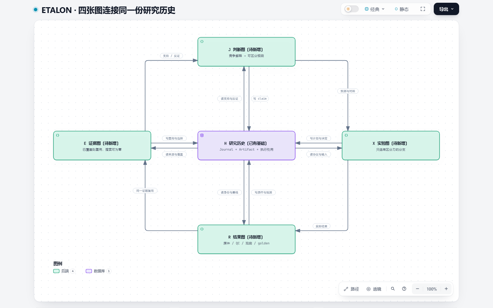

# MolDarwin 四图研究架构

研究沿已有证据、科学判断、实验、新结果形成可选的关系网络，四图共享研究历史 H。节点标明已有接口、待新增能力或需要扩展的部分 —— 这些标注是作图当时的，此后多数"待新增"已经实现，逐条实况见 [DESIGN.md](DESIGN.md) 开头的状态节。本目录是设计和图示，不是新增科学实现。

## 阅读入口

- [具体设计](DESIGN.md)：四图关系、memory 契约、检索与更新、新 chat 接续、S/U RSI 触发及代码对应。
- [交互架构图总入口](index.html)：下载本目录或 checkout 本分支后，用浏览器打开 index.html；GitHub 文件页本身不会运行 HTML。
- [逐步 memory 读写图](memory/preview.png)。
- [新 chat 与 RSI 关系图](continuation-rsi/preview.png)。
- 总入口第四个视图保留之前的 Skills / SDK 能力图。

E/J/X/R 不是四套数据库，也不是必经流水线。**按 2026-11-25 的代码核对：它是一次读取时的投影。**节点 kind 由 `src/moldarwin/research/graph_memory.py:188` 按记录的 `operation`/`record_type` 推断，不落盘、无索引、不能作为查询条件；代码在每个节点盖 `kind_basis: "legacy_record_semantics_inferred"`。目前只有 `J` 被读取，`E`/`X`/`R` 只写不读，`E` 是推断链的兜底分支。投影与有类型的边（8 种）是真的；承载 admission 推理的是边的 `relied_on`/`used` 分类（`src/moldarwin/learn/admission_view.py`），它不读节点 kind。每层可以只读已有证据，分支可以停止。RSI 限于方法 S 与使用/分支选择 U；资源分配不纳入**本设计**的改进对象（系统本身已有分配与设备迁移机制，见 DESIGN.md 开头）。

## 来源与校验

[SOURCE_MANIFEST.json](SOURCE_MANIFEST.json) 固定现有实现的源码字节身份；[VALIDATION.json](VALIDATION.json) 记录图与候选 JSON 的哈希、源码提交、自动校验及浏览器检查。图内源码链接固定到对应 Git 提交。

图、候选 JSON 与 SOURCE_MANIFEST.json 生成于 2026-11-25 改名之前，保持原字节：图内标题与源码路径是当时的名称 ETALON，源码链接指向 `github.com/AIB001/ETALON` 的固定提交，预览图中的标题也是当时渲染的。换成新名称需要更新候选 JSON 并按下文重新生成。

四幅图均通过 Archify 的 schema、交付、完整性与真实浏览器检查。三个新增图已查看 1440×900 浅色截图；入口四个标签的加载、切换与横向溢出检查通过。这些检查不替代科学试验或完整 RSI 效果验证。

每个子目录的 candidate.json 是可编辑图源。重新生成时使用 Archify 3.1 的 finalize architecture 命令，以仓库根目录作为工作目录、当前仓库作为 --repo-root，并采用候选内 meta.output 指定的相对输出路径。先确保 source_revision 对应的提交可用；输出后重新校验，不直接编辑已生成 HTML。
